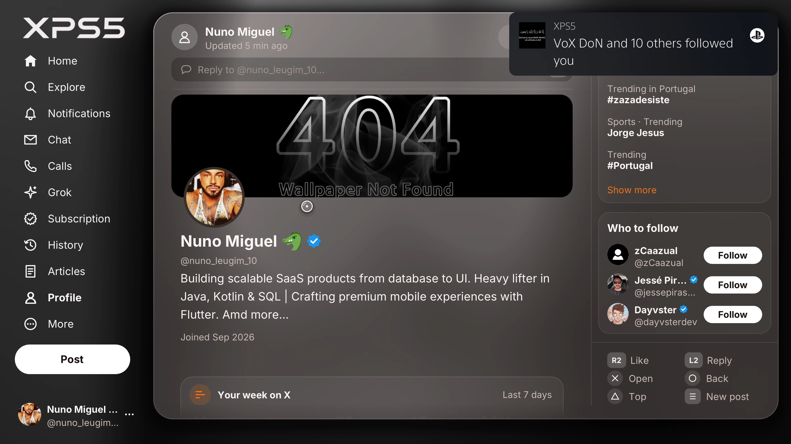
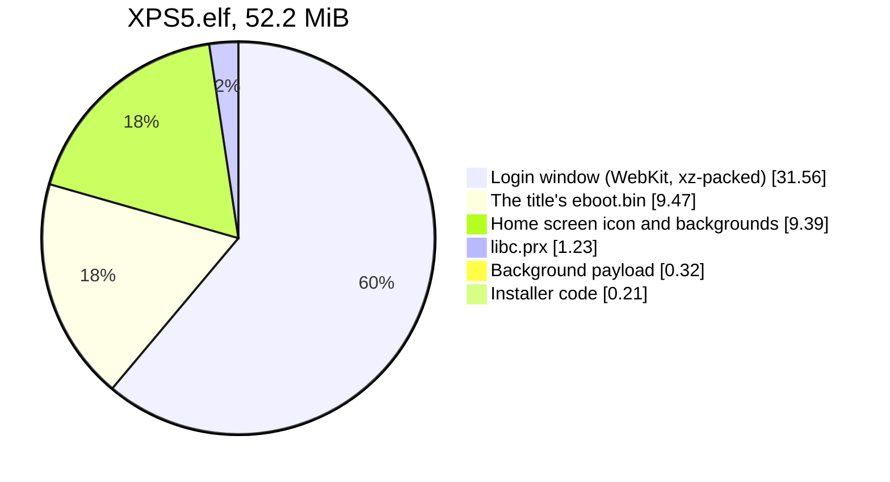
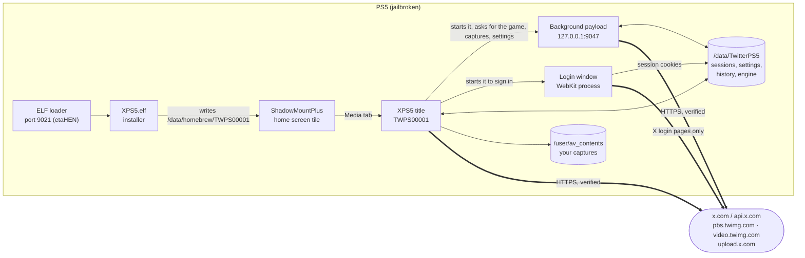
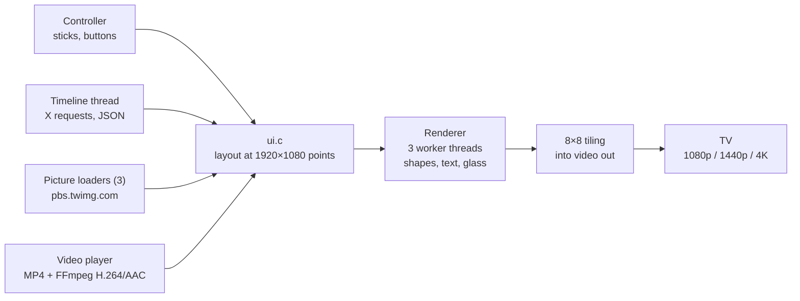
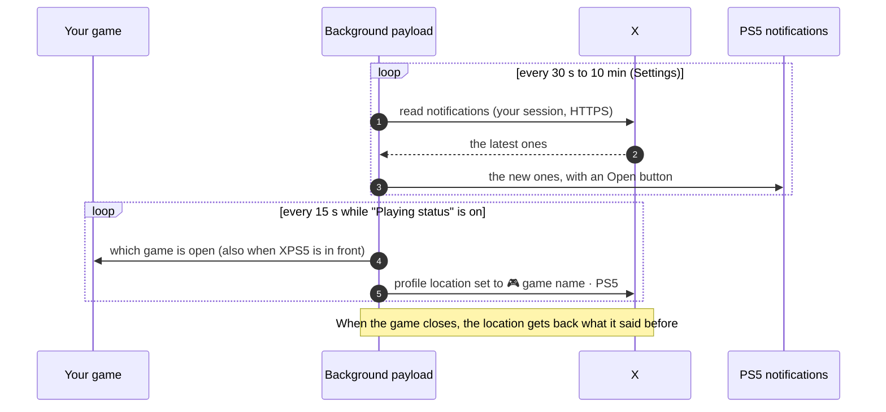
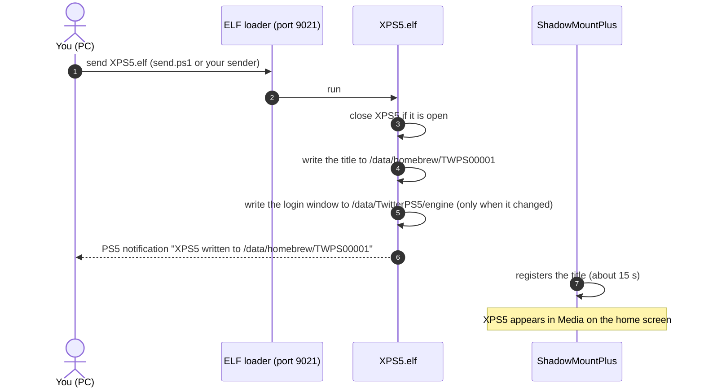

# XPS5 — X on your PS5, as a native app

-0070d1)


XPS5 is an unofficial X (Twitter) client for jailbroken PS5 consoles. It is a **real native title** (`TWPS00001`) in the home screen's Media tab, beside your game. It is not a browser and not a web view: every pixel is drawn by XPS5's own renderer, and you use it with the controller.



<sub>Captured on a PS5 at 3840×2160. The notification in the top right corner is one of XPS5's own PS5 notifications.</sub>

> [!WARNING]
> **Read first.** XPS5 is an unofficial homebrew project. It is **not affiliated with, endorsed by or connected to X Corp., Sony Interactive Entertainment or anyone else**. It needs a jailbroken PS5. **Use it at your own risk**: you alone are responsible for your console and your X account. X may ask you to verify your account, or lock it for a while (error 326); if that happens, unlock it at x.com.

---

## Contents

- [Features](#features)
- [Technical specifications](#technical-specifications)
- [How it works](#how-it-works)
- [Requirements](#requirements)
- [Installation](#installation)
- [Logging in](#logging-in)
- [Controls](#controls)
- [Settings](#settings)
- [Updating and uninstalling](#updating-and-uninstalling)
- [Files on the console](#files-on-the-console)
- [Privacy and security](#privacy-and-security)
- [Troubleshooting](#troubleshooting)
- [Building from source](#building-from-source)
- [Project layout](#project-layout)
- [Roadmap](#roadmap)
- [Licences](#licences)

---

## Features

### X, the way you know it

- **Timelines**: For you and Following, with pictures, videos, GIFs, quotes, polls, badges and counts. Long posts show whole. Following remembers where you left off.
- **Post and reply** with the PS5 keyboard: up to 4 screenshots or 1 clip straight from your PS5 captures, polls, quotes and scheduled posts (X Premium).
- **Like, repost, bookmark, follow, mute and block**, and a post's ••• menu as on x.com: delete, pin, and edit (X Premium).
- **Explore** (Trending and News, without promoted items), **search**, **Notifications**, **Chat** (direct messages; encrypted X Chat conversations only open in X's own apps), **Bookmarks**, **Lists**, **Scheduled posts**, **History** and **Articles**.
- **Profiles** with banner, bio, counts and their posts, and **Who to follow**.
- **Up to 5 X accounts** on one console, switched from the account menu at the bottom of the bar.

### Made for the PS5

- **X notifications over your game**: likes, reposts, follows, replies and mentions arrive as real PS5 notifications, with an **Open** button. You choose how often they are read, from every 30 s to every 10 min.
- **It knows what you are playing**: the game and its hashtag go into the composer, and that game's captures come first.
- **Playing status** (optional): your X profile's location shows `🎮 <game> · PS5` while you play, and gets back what it said before when you stop.
- **Playing now**: which people you follow are playing, and what.
- **Spoiler shield**: posts about the game you are playing stay covered until you open them.
- **New screenshot or trophy?** XPS5 offers to post it on X.
- **Rising posts**: it tells you when one of your posts is taking off.
- **Grok hints** without spoilers for the game you are playing.
- **Videos** in the sharpest MP4 X offers for each one, with sound, in the timeline and full screen.
- **7 languages** (English, Português, Español, Français, Deutsch, Italiano, Nederlands), following your PS5's language.
- **Day and Night themes**, rendered at your TV's resolution, up to 4K. The controller's light bar takes the colour of the banner on screen.
- **Updates itself** (from 1.0.1): it tells you when a new version is out, and installs it from *Settings → Updates*.

---

## Technical specifications

| | |
| --- | --- |
| **Type** | Native PS5 title, media category (`applicationCategoryType` 65536), title ID `TWPS00001` |
| **Language** | C (37,860 lines in 78 files), plus 1,844 lines of C/C++ for the login window and 9,845 lines of host tests |
| **Rendering** | Own CPU renderer: anti-aliased shapes, TrueType text, frosted glass, pictures. The layout is 1920 × 1080 points, drawn at the picture's real pixels by 3 worker threads, then copied in 8 × 8 tiles straight into the PS5's video out buffers |
| **Resolutions** | 1080p, 1440p and 2160p (4K); *Auto* uses the TV's own resolution |
| **Text** | Inter and DejaVu Sans (stb_truetype), UTF-8 with emoji, line breaking and fallback fonts |
| **Network** | HTTPS through the PS5's own `libSceHttp` / `libSceSsl`. Certificates are **always verified**; payloads get no system CA store, so XPS5 ships its own Let's Encrypt roots (ISRG Root X1, X2, YR) |
| **X access** | X's web endpoints (GraphQL), the same requests x.com makes, with your own session and a computed `x-client-transaction-id`. No API key, nothing paid |
| **Video** | Own MP4 reader (progressive and fragmented) and FFmpeg 8.1.3's H.264 and AAC decoders, picture and sound kept in sync; seen playing up to 3840 × 2160 |
| **Uploads** | Your screenshots and clips are read from `/user/av_contents` and uploaded to X in parts of up to 4 MiB, the way x.com's composer does it |
| **Pictures** | Kept in memory with a budget that follows the free flexible memory (210 MiB on a PS5 at 4K) |
| **Background payload** | A 333 KiB ELF that keeps running after XPS5 closes: X notifications, the game you play, the playing status, captures for the title. It answers XPS5 on `127.0.0.1:9047` |
| **Login window** | A WebKit build for the PS5 that runs as a separate process and is drawn inside XPS5 (ports 9073–9080 on the console). About 144 MiB on disk, 31.6 MiB packed in the installer |
| **Accounts** | Up to 5 |
| **Languages** | 7 |
| **Install size** | `XPS5.elf` 52.2 MiB, `XPS5-uninstall.elf` 109 KiB |
| **Tested on** | PS5 firmware 13.60 with etaHEN and ShadowMountPlus |
| **Updates** | `update.json` (version, file, size, SHA-256) and the installer on GitHub Pages, filled from each release by a GitHub Actions workflow; the download is checked by size and SHA-256 before the ELF loader gets it |
| **Host testing** | Every module that does not need the console is tested on a PC with AddressSanitizer and UndefinedBehaviorSanitizer |

### Where the code goes

```mermaid
pie showData
    title XPS5's own code by part (lines of C)
    "Screens and layout (ui.c)" : 12628
    "Background payload" : 6049
    "X client (GraphQL, HTTPS, TLS, JSON)" : 5311
    "App core (main.c)" : 3598
    "Video, sound and captures" : 3226
    "Renderer (shapes, text, pictures, video out)" : 3221
    "Installer and uninstaller" : 2107
    "Languages, keyboard, PC login" : 1720
```



### What is inside `XPS5.elf`



---

## How it works

### The pieces on the console



### A frame on screen



### Notifications and the playing status



### Installing



---

## Requirements

- A **jailbroken PS5** with an **ELF loader on port 9021** (etaHEN starts one).
- **ShadowMountPlus** running, which puts titles installed in `/data/homebrew` on the home screen. Without it, XPS5's files are installed but no tile appears.
- An **internet connection** and an **X account**.
- To send the ELF from a PC: any payload sender, or `send.ps1` (Windows PowerShell) from the release.

---

## Installation

1. **Download** the latest `XPS5-<version>.zip` from the [Releases](../../releases) page and unzip it.
2. **Check the files** (optional, recommended). In PowerShell, in the unzipped folder:

   ```powershell
   Get-FileHash .\XPS5.elf -Algorithm SHA256
   ```

   The result must match the line for `XPS5.elf` in `SHA256SUMS.txt`.
3. **Load your jailbreak** on the PS5 (etaHEN), and make sure ShadowMountPlus is running.
4. **Send `XPS5.elf` to port 9021** with the payload sender you already use. On Windows, the included `send.ps1` does it:

   ```powershell
   .\send.ps1 -Ps5 <your PS5's IP> -Elf .\XPS5.elf
   ```

   Find the PS5's IP in *Settings → Network → Connection Status → View Connection Status*. If PowerShell refuses to run the script, run it once with `powershell -ExecutionPolicy Bypass -File .\send.ps1 -Ps5 <IP> -Elf .\XPS5.elf`.
5. **Wait for the notification** *"XPS5 written to /data/homebrew/TWPS00001 …"*. The first install also writes the login window (about 144 MiB), so give it a moment.
6. **Open XPS5** from **Media** on the home screen. ShadowMountPlus adds it in about 15 seconds. The icon and background may only show after the PS5 restarts.
7. Press ✕ on **Log in to X** and sign in (see below).

---

## Logging in

Open XPS5 and press ✕ on **Log in to X**. X's own login page opens in a window inside XPS5: sign in with your username, email or phone and your password, as on x.com.

| In the login window | |
| --- | --- |
| Left stick | Move the pointer |
| ✕ | Click |
| △ | Open the PS5 keyboard for the field you are on |
| ↑ ↓ | Next or previous field |
| ○ | Close the window |

- Your password goes **only to X**, over HTTPS. XPS5 never keeps it.
- Only X's pages open in that window, so *Sign in with Google / Apple* does not work there. Its pages, cookies and cache are deleted when it closes.
- XPS5 keeps only X's two session cookies (`auth_token` and `ct0`) in `/data/TwitterPS5/session.txt` (`session2.txt` … `session5.txt` for the other accounts), on your console.
- The window tells X it is a PlayStation 5 browser, which it is.

**From a PC instead**: *Link your account from a PC* shows a QR code and an address. With the **XPS5 Login** extension (`tools/xps5-login-extension`, for Chrome, Edge and Firefox) on a browser signed in to x.com, open that address and press **Link**. The link only works on your home network while that screen is open.

**Accounts**: the account at the bottom of the bar opens a menu, as on x.com: your accounts on this console, **Add an existing account** and **Log out**. Logging out removes that account's session from the PS5.

---

## Controls

The left stick moves a pointer, and ✕ presses what is under it. The right stick scrolls. The side column always shows what each button does on the page you are on.

| Button | What it does |
| --- | --- |
| ↑ ↓ | Previous or next post |
| ← → | The sections of the bar |
| L1 / R1 | A page up or down |
| ✕ | Open the post (or press what the pointer is on) |
| ○ | Back |
| R2 | Like, or take the like back |
| L2 | Reply |
| Options | New post |
| △ | Back to the top (at the top of Explore: search) |
| □ | Refresh |
| PS | Back to your game |

---

## Settings

*More → Settings*:

| Setting | Values |
| --- | --- |
| Language | The PS5's, or one of the 7 |
| Theme | Day or Night |
| Screen | Auto (the TV's), 1080p, 1440p or 4K |
| Notifications over the game | On or off, read every 30 s, 1, 2, 5 or 10 min |
| Playing status in your X profile | On or off (off by default) |
| Spoiler shield, light bar colour, rising posts | On or off |
| Video sound, videos in the timeline, data saver | On or off |
| Break reminder | Off, 30, 60 or 120 min |
| Updates | Your version; ✕ looks for a new one, or installs the one found |

---

## Updating and uninstalling

**Updating inside XPS5** (from 1.0.1): XPS5 looks for a new version each time it opens, and again when you press ✕ on *Settings → Updates*. When one is out, that row says so: press ✕ and XPS5 downloads it from the project's GitHub Pages, checks its size and SHA-256 against `update.json`, and hands it to the ELF loader on port 9021. The installer then closes XPS5 and writes the new version: open it again from the home screen. Version 1.0.0 does not look for updates, so install 1.0.1 by hand once.

**Updating by hand**: send the newer `XPS5.elf` the same way as the first time. The installer closes XPS5 by itself if it is open.

Either way, your accounts and settings stay, and the login window is only written again when it changed. A running background payload from an older version is replaced the next time XPS5 opens.

**Uninstalling**: send `XPS5-uninstall.elf` the same way:

```powershell
.\send.ps1 -Ps5 <your PS5's IP> -Elf .\XPS5-uninstall.elf
```

It closes XPS5, gives each X profile that shows a game the location it had before, stops the background payload, asks ShadowMountPlus to take the tile off the home screen, and deletes everything XPS5 wrote (below). Your captures and your other titles are not touched.

---

## Files on the console

| Path | What is there |
| --- | --- |
| `/data/homebrew/TWPS00001/` | The title: `eboot.bin`, `libc.prx`, `sce_sys/` (icon, backgrounds, `param.json`), the background payload |
| `/data/TwitterPS5/session.txt`, `session2.txt` … | Each account's two X cookies |
| `/data/TwitterPS5/settings.txt` | Your settings |
| `/data/TwitterPS5/history.bin` | The posts you opened (History) |
| `/data/TwitterPS5/playingN.txt` | What each profile's location said before the playing status |
| `/data/TwitterPS5/engine/` | The login window |

---

## Privacy and security

- XPS5 talks **only to X**: x.com and X's servers for pictures, videos and uploads, and, in the login window, whatever X's own login page loads.
- The one exception is its own updates: it reads `update.json` from `ramalhoboss.github.io` when it opens and when you look for updates, and downloads the installer from there when you choose to install. Those requests carry no account data or cookies.
- Your sessions, settings and history **stay on your console**.
- HTTPS certificates are always verified. There is no "accept any certificate" mode.
- The console's log (klog) only gets **status codes and counts**: never your session, posts, messages, addresses or what you type.
- The ELF files contain no account data, so they can be shared.
- XPS5 does not change any PS5 system setting.

---

## Troubleshooting

| What you see | What to do |
| --- | --- |
| No XPS5 tile after installing | ShadowMountPlus is not running, or has not scanned yet: start it and wait about 15 s |
| The tile has no icon or background | Restart the PS5 once |
| *Not refreshed (no connection)* | Check the PS5's internet connection, then press □ |
| *Not refreshed (HTTP 401/403)* | The session expired or was ended from X: log in again |
| X error 326 | X locked the account for a check: unlock it at x.com |
| No notifications over the game after a restart | Open XPS5 once: it starts the background payload again |
| The installer's notification never comes | Make sure the ELF loader listens on port 9021 (load etaHEN again) |

---

## Building from source

For developers. You need:

- Windows with LLVM/clang in `C:\Program Files\LLVM` (`winget install LLVM.LLVM`);
- the prebuilt **ps5-payload-sdk** (`build.ps1 -Sdk <dir>`);
- WSL (Ubuntu 24.04) with clang 18 and **PS5_Vulkan** in `~/src/PS5_Vulkan`, and FFmpeg 8.1.3 built for the PS5 (see `title/build-title.sh`).

```powershell
.\build.ps1 -Wsl Ubuntu-24.04      # the title, the payloads, build\XPS5.elf and build\XPS5-uninstall.elf
.\tools\release.ps1                 # build\release\XPS5-<version>\ and its zip, with SHA256SUMS.txt
```

Without `-Wsl`, `build.ps1` reuses the title already in `build\title`.

**Publishing a release**: set the version in `src/update.h` (`XPS5_VERSION`), build, run `tools\release.ps1`, then publish a GitHub release tagged `v<version>` with `XPS5.elf` attached (and the rest of `build\release\XPS5-<version>\`). The workflow `.github/workflows/pages.yml` then puts that `XPS5.elf` and its `update.json` on GitHub Pages, where every XPS5 from 1.0.1 on finds it. It can also be run by hand from the Actions tab. Pages must be set to deploy from GitHub Actions (*Settings → Pages → Source*). A fork points `XPS5_UPDATE_URL` in `src/update.h` at its own Pages.

The login window is built separately in WSL by `tools/login-engine`: `build-engine.sh build` (WebKit), `build-login.sh` (the window), then `pack-engine.sh`, which `build.ps1 -Wsl` runs and which puts the packed engine in `build\engine`. Without it, the installer installs XPS5 without its login window.

Tests run on the PC, in WSL, with the address and undefined-behaviour sanitizers:

```sh
sh tests/host-test.sh           # JSON, X's answers, transaction ids, MP4, QR, trophies, settings, text, drawing…
sh tests/preview.sh <out dir>   # draws XPS5's screens into PNG files with made-up posts
```

---

## Project layout

```
XPS5/
├── .github/workflows/pages.yml  puts each release's installer and update.json on GitHub Pages
├── build.ps1                 builds everything (Windows + WSL)
├── send.ps1                  sends an ELF to the PS5's ELF loader
├── certs/                    Let's Encrypt root certificates bundled into the payloads
├── src/                      shared code and the payloads
│   ├── xapi.c  xtid.c  xsign.c   X's web requests and their transaction ids
│   ├── https.c tls.c json.c      HTTPS over libSceHttp, certificates, a JSON parser
│   ├── notify.c xnotify.c toast.c the background payload and PS5 notifications
│   ├── play.c  game.c  trophy.c  the game you play, the playing status, trophies
│   ├── mp4.c   jpeg.c  captures.c video files, JPEG, your PS5 captures
│   ├── install.c uninstall.c     the installer and the uninstaller
│   └── link.c linkserve.c qr.c   linking an account from a PC
├── title/                    the native title (TWPS00001)
│   ├── main.c                    threads, requests, the main loop
│   ├── ui.c                      every screen and its layout
│   ├── draw.c text.c images.c    the renderer
│   ├── video.c workers.c         video out, tiling, worker threads
│   ├── player.c sound.c          the video player and sound
│   ├── lang.c lang_table.h       the 7 languages
│   ├── art/ fonts/               icon, backgrounds, Inter and DejaVu
│   └── build-title.sh            builds eboot.bin in WSL
├── tests/                    host tests and the screen previewer
├── third_party/stb/          stb_truetype, stb_image
└── tools/
    ├── login-engine/             builds and packs the login window
    ├── xps5-login-extension/     the browser extension for linking from a PC
    └── release.ps1               puts a release together
```

---

## Roadmap

- [ ] Test more firmware versions
- [ ] Invites to play: a DM that opens the game on your friend's PS5 (in testing)
- [ ] Send a capture straight into a DM (in testing)
- [x] Update check inside XPS5, from the GitHub releases (1.0.1)
- [ ] Sign in with Google and Apple in the login window
- [ ] More PSN-style social features on top of X
- [ ] Your ideas: open an issue

**Next release: BrowserPS5 RN** 👀

---

## Licences

XPS5 is free software under the **GNU General Public License, version 3 or later** (`LICENSE`), since it includes code under that licence. It includes or links:

- video code from PS5_Vulkan (GPL-3.0-or-later);
- **FFmpeg 8.1.3** (libavcodec, libswresample and libavutil, decoders only), statically, under the GNU Lesser General Public License 2.1 or later: https://ffmpeg.org, source at https://ffmpeg.org/releases/ffmpeg-8.1.3.tar.xz. `title/build-title.sh` shows how it is linked (its allocation, thread and time functions renamed to `title/ffmem.c`), so the title can be relinked with another build of it (`FFMPEG=<dir>`);
- the Inter font (SIL Open Font License 1.1, `title/fonts/LICENSE-Inter.txt`), the DejaVu fonts (`title/fonts/LICENSE-DejaVu.txt`), and stb_truetype and stb_image (public domain);
- in the login window:
  - WebKit (GNU LGPL 2.1 or later, and BSD licences), with changes for the PS5, as a shared library (`libWebKitXps5.so.SOVERSION`) that can be replaced. Built into it, from the ps5-payload-sdk: libcurl (curl licence), OpenSSL 3.5 (Apache 2.0), ICU 74 (Unicode licence), cairo (LGPL 2.1 or MPL 1.1), FreeType (FreeType licence), Fontconfig (MIT), HarfBuzz (MIT), libpng (libpng licence), libjpeg (IJG licence), libwebp (BSD), libxml2 (MIT), libpsl (MIT), Brotli (MIT), zlib (zlib licence), libwpe (BSD) and SQLite (public domain);
  - Mesa's libEGL (MIT);
  - elfldr (GPL-3.0-or-later), changed in one line to give the processes it starts an environment;
  - Mozilla's list of root certificates (MPL 2.0), from Ubuntu's ca-certificates;
- in the installer: XZ Utils' liblzma 5.4 (public domain), from the ps5-payload-sdk.

The source of the WebKit build used by the login window, with its changes for the PS5, is available on request: open an issue on this repository. The scripts that build and pack it are in `tools/login-engine`.

X is a trademark of X Corp. PlayStation and PS5 are trademarks of Sony Interactive Entertainment. XPS5 is not affiliated with either.
